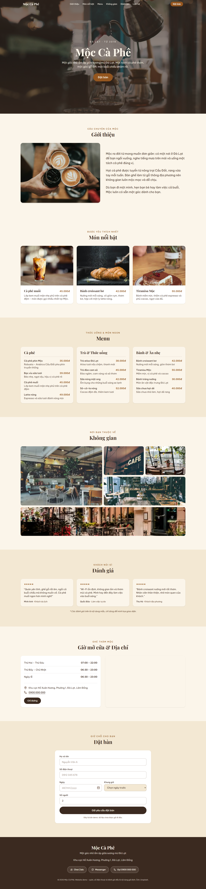

# Mộc Cà Phê – Landing page

Landing page cho quán cà phê giả định **Mộc Cà Phê** ở Đà Lạt. Giao diện ấm áp (nâu/kem), toàn bộ nội dung tiếng Việt, ưu tiên mobile.

> Đây là dự án demo: tên quán, địa chỉ, số điện thoại và các đánh giá đều là nội dung mẫu. Ảnh lấy từ [Unsplash](https://unsplash.com).

## Ảnh chụp màn hình

| Desktop (1440px) | Mobile (390px) |
| --- | --- |
|  |  |

## Tính năng

- Header trong suốt ở đầu trang, đổi sang nền nâu đậm có bóng khi cuộn; menu hamburger trên mobile (tự đóng khi bấm link)
- Hero ảnh lớn với nút **Đặt bàn**
- Giới thiệu, **Món nổi bật** (3 món có ảnh, giá), Menu chia nhóm (giá VNĐ)
- Gallery Không gian: ảnh phóng nhẹ khi hover, bấm để mở lightbox (nút đóng, phím Esc, bấm nền để đóng)
- Đánh giá khách hàng (ghi rõ là nội dung mẫu)
- Giờ mở cửa, số điện thoại, nút **Chỉ đường** + Google Maps nhúng (tiếng Việt)
- Form đặt bàn có kiểm tra dữ liệu: ô ngày dd/mm/yyyy, dropdown giờ mỗi 30 phút theo giờ mở cửa; thành công hiện khung tóm tắt đơn đặt (chưa gửi dữ liệu đi đâu)
- Mobile: thanh cố định dưới đáy với nút **Gọi** / **Đặt bàn** (ẩn khi đang ở phần đặt bàn)
- Hiệu ứng fade-up khi cuộn (IntersectionObserver), tự tắt khi bật `prefers-reduced-motion`
- Footer với nút Zalo / Messenger / Gọi điện
- SEO cơ bản: title, description, Open Graph, `lang="vi"`

## Công nghệ

Next.js (App Router) · TypeScript · Tailwind CSS v4 · `next/image` · `next/font` (Be Vietnam Pro, Playfair Display – có subset tiếng Việt) · lucide-react · Playwright (chụp ảnh màn hình)

## Chạy local

```bash
npm install
npm run dev        # http://localhost:3000
npm run build && npm start
```

Chụp lại ảnh màn hình (cần server đang chạy ở cổng 3000):

```bash
npx playwright install chromium
node scripts/screenshots.mjs
```

## Tùy chỉnh

- Nội dung, menu, giờ mở cửa, số điện thoại, link Zalo/Messenger: `lib/data.ts`
- Biến môi trường tùy chọn `NEXT_PUBLIC_SITE_URL` – URL thật của site (dùng cho Open Graph)
- Để nhận đơn đặt bàn thật, thay phần `TODO` trong `components/BookingForm.tsx` bằng lời gọi API/email.
